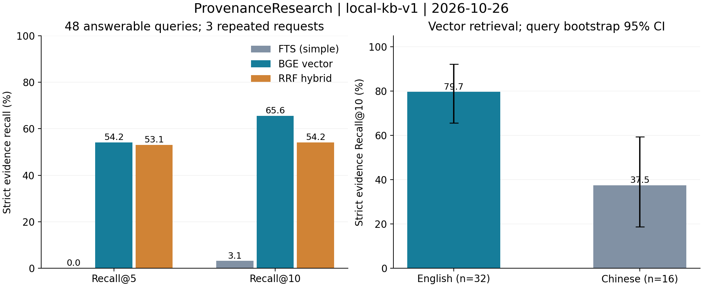

# 本地知识库正式测评报告（2026-10-26）

## 结论

已完成真实检索360次HTTP请求（每轮60题×3次，两轮），以及168次真实云Agent任务（首轮120次、低频补测48次）。主检索指标：BGE向量严格证据Recall@10为65.625%，MRR@10为0.5481；英文32题Recall@10为79.6875%，中文16题为37.5%。这是自建候选题集的源文覆盖测量，不是回答准确率或公开榜单成绩。

**尚不能证明Agent改进有效。** 首轮受到大量429影响；低频补测消除了大部分服务干扰，但当前版在20道可回答题中仅作答1道，旧版5道，当前版19次invalid_planner_output。保留此负面结果，不用连接成功、拒答数或引用ID完整率替代回答质量。

## 固定条件与可追溯性

| 项目 | 实际条件 |
| --- | --- |
| 题集 | local-kb-v1，60题：36单源、12多源、12证据不足；48道可回答题中英文32、中文16 |
| 标注 | 62个原文事实片段；全部可映射至实际chunk；human_verified=0，尚未人工裁决 |
| 语料 | 16份固定原件：11份中文法律、3份RFC、NIST SP800-207及AI RMF；上传完整PDF/TXT |
| 入库 | 实际上传→Worker→解析/分块→BGE→PostgreSQL/Qdrant，共1892个有效child chunks |
| Embedding | BAAI/bge-base-en-v1.5，768维、归一化，CPU，本地固定官方权重；用户授权的Embedding例外 |
| 生成 | Agnes agnes-3.0-flash；真实云调用，温度0、每次最大输出1024、零重试 |
| 检索比较 | 现有PostgreSQL FTS simple、BGE向量、RRF混合；reranker关闭，统一law/standard全语料范围，无目标文档过滤 |
| Agent比较 | reference为8486709的原AgentLoop；current为当前AgentLoop；共用当前provider、reader、证据与工具，不复现整个历史系统 |
| 工具/预算 | 仅kb_search/evidence_read；每题3轮、5次工具、8000 token；禁止web和先验补证据 |
| 首轮 | 425fca329abec1e908dcdbb61e515676084d3ad4，干净工作区；60题×两版各1次，并发3、deadline120秒 |
| 低频补测 | 1d41b2f29c60fe1e2adb94790c0a3faeb1b583b1，干净工作区；24题×两版各1次，并发1、全局请求开始间隔15秒、deadline600秒 |
| 隔离资源 | research_eval_local_v1数据库、eval_local_bge_768_v1集合、Redis DB4、知识引擎8002；不覆盖日常库 |
| 机器 | Windows 11，32逻辑核，Embedding CPU；完整环境版本和权重SHA见metadata |

两轮均在开始和结束验证DB chunk与Qdrant成员/payload哈希一致。索引身份：model=bge-base-en-v1.5;dim=768;normalize=true;preprocess=v1。chunk哈希为0a107a72ef2085332fd2d6f8f24ed9d87cc001183007c51a3da66275af39c9ec；Qdrant哈希为90f4effc1980bc2af8587f5f1936c3e690fad01d5fd0cdf53176a964f6462c67。

低频补测在首轮故障后单独制定，并非事前盲测。按题号与固定种子SHA256排序分层抽取：英文单源8/多源4、中文单源4/多源4、证据不足4；不读取首轮成功失败结果选题。具体题号与规则固定于paced.json。两版运行条件相同，保留原轮全部失败；两轮题目和运行条件不同，不能比较其Agent耗时来声称提速。

## 检索结果

命中要求同时满足正确document UUID，以及chunk中包含完整目标原文片段（NFKC、去空白、不分大小写）；同文档的其他段落不算命中。每题先平均3次结果，再对48道可回答题等权平均。12道证据不足题照常执行，但不计入Recall分母。MRR按第一个命中目标事实的位置计算，不要求命中全部事实。

| 检索通道 | Recall@5 | Recall@10 | MRR@10 |
| --- | ---: | ---: | ---: |
| FTS simple | 0.00% | 3.125% | 0.0052 |
| BGE向量 | 54.167% | **65.625%** | **0.5481** |
| RRF混合 | 53.125% | 54.167% | 0.4656 |

BGE Recall@10的查询级bootstrap 95%区间为53.125%–78.125%（2000次重采样）；MRR区间0.4220–0.6756。统计单位为题目，不能把三次重复当作144个独立样本。

| BGE分组 | 题数 | Recall@5 | Recall@10 |
| --- | ---: | ---: | ---: |
| 英文 | 32 | 68.750% | 79.688% |
| 中文 | 16 | 25.000% | 37.500% |
| 单源 | 36 | 61.111% | 72.222% |
| 多源 | 12 | 33.333% | 45.833% |

在12道多源题上，另行检查Top5是否覆盖该题的**全部目标事实**：FTS为0/12（0%），BGE为2/12（16.667%），RRF为1/12（8.333%）。这与上表允许部分事实命中的平均Recall不同，不能把45.833%的多源Recall@10称为完整回答率。

两轮各180次真实HTTP请求，返回每次keyword/vector/hybrid三路排名，各540条评分记录；两轮汇总指标一致，每轮各通道60题的三次Top10均一致，HTTP错误0。首轮混合检索完整接口热态p50为557.3ms、p95为1156.1ms；补测p50为331.4ms、p95为747.7ms。该耗时包含接口中的多路检索，不能归为向量单路耗时；不同运行时段有波动，不作代码加速结论。

本组结果中混合检索低于纯向量，且FTS基线很弱。不能宣传“混合检索提升召回”，也不能将对这一弱基线的差值推广到优化后的关键词检索。英文模型在中文组结果较低，与模型适用语言存在一致现象，但本实验未进行模型切换因果对照。

## Agent结果：首轮完整60题对照

| 每版60次 | 旧版reference | 当前current |
| --- | ---: | ---: |
| answered / refused / error | 0 / 13 / 47 | 0 / 18 / 42 |
| 可回答题作答数（分母48） | 0 | 0 |
| HTTP429错误 | 46 | 38 |
| invalid_planner_output | 0 | 15 |
| 已报告输入/输出token | 26902 / 3647 | 51414 / 9617 |
| 云调用尝试 | 100 | 88 |
| 用量不完整的任务数 | 47 | 42 |

首轮无答案通过现有闸门；服务限流占主要影响，不能将此轮的作答差异归因于算法。所有错误和拒答仍保留在分母。

## Agent结果：独立低频24题补测

每版20道可回答题、4道证据不足题。同模型、同题、同工具预算；两版顺序交替，但模型非确定性与供应商时段效应仍未消除。

| 指标 | 旧版reference | 当前current |
| --- | ---: | ---: |
| answered / refused / error | 5 / 19 / 0 | 1 / 22 / 1 |
| 可回答题作答率 | 5/20 = 25% | 1/20 = 5% |
| 可回答题拒答数 | 15/20 | 18/20，另1次error |
| 严格目标事实引用覆盖（20题，失败计0） | 20% | 5% |
| invalid_planner_output | 0 | 19 |
| budget_exhausted | 0 | 2 |
| citation_gate_failed | 8 | 1 |
| no_evidence | 11 | 0 |
| 证据不足题有效拒答（排除运行故障） | 4/4 | 0/4 |
| 运行故障数（含规划格式/预算/异常） | 0/24 | 22/24 |
| 已报告输入/输出token | 48031 / 5159 | 58415 / 9220 |
| 实际云调用尝试 | 75 | 48 |
| 用量不完整的任务数 | 0 | 1 |
| 实测token超过8000的任务数 | 0 | 2 |
| 单题热态p50 / p95（包含限速等待） | 54.55s / 84.19s | 22.46s / 72.16s |

当前版4道负例虽然均返回refused，但均属于运行故障，不能记成有效的证据不足拒答。当前版更短的耗时主要伴随大量早停，不能视为性能收益。8000 token为现有软预算，实际prompt可越界；本次如实记录两次越界，未修改算法以美化指标。唯一ProviderError发生于en-001，不含429；不将其擅自归类为限流。

补测输出共13个结构化claim（旧12/现1），引用ID和来源必填字段完整率均100%；这是身份完整性检查，不是内容被原文支持的准确率。旧版en-028只回答了多源问题的一部分，严格目标片段引用覆盖为0，说明“answered”也不代表完整正确。人工语义评分仍为空；内部SemanticVerifier与生成共用同一模型，不能充当独立裁判。

## 成本、边界与解释

首轮成功返回的已知token合计91580；补测120825；总计212405，仅为已知用量下界。计分任务共311次实际云调用尝试，错误调用可能缺usage。单独的连接容量探针不计入测评分数：1次调用，已知80 token。其他此前配置/smoke不包含在本报告成本内。无已验证的供应商单价或完整账单，货币费用记为未知，不声称免费或节省成本。

这是一组自建、小规模、公开原文锚定的开发评测，存在同源文档相关性、候选标注和选择偏差风险；生成每题每版仅1次，不能作统计显著提升结论。未测试OCR、图片识别、扫描件识别质量、联网研究、并发吞吐、冷启动或跨硬件性能。RFC TXT在现有解析路径中不保留真实PDF页码，不计算页码准确率。未人工核验，不将本次完成写成旧路线图P4或多模态阶段验收。

后续若另行批准修复，应优先检查规划输出协议与解析契约，使用独立开发集修复，再冻结新版本重跑；同时保留本次作为基线。不能修改此题集或历史结果后追认当前版更优。

## 产物与复现

- 固定题集与条件：eval/benchmarks/local_kb_v1/questions.jsonl、freeze.json、paced.json；方法见local-kb-evaluation-plan.md。
- 可随Git保留的汇总、环境、前后审计、原始文件SHA256清单和图表：eval/reports/local-kb-v1-20261026/。
- 本机完整原始逐题证据：eval/results/local-kb-v1.20261026-formal-01/及local-kb-v1.20261026-paced-01/（gitignored，未上传）；manifest.json记录文件哈希。此清单可校验本机留档，但不是远端独立见证。
- human-review.csv包含168条实际任务的状态和输出，语义评分/审核人留空；可用于后续人工裁决，不能将空白当作已验收。
- 运行前需.env有效云配置、固定本地BGE、独立数据库与服务；先运行`.venv/Scripts/python.exe -m eval.local_kb_setup`准备，再在上述测量提交上使用`.venv/Scripts/python.exe -m eval.local_kb --profile original --phase all --output <新目录>`或`--profile paced`。原始提交425fca3尚无--profile参数，省略该参数。复现会产生真实云调用；当前HEAD不同不应续写旧目录。
- 代码回归：核心六目录180 passed；仓库契约通过；两轴代码审查的问题均已修复。单元测试结果与质量评测结果分开报告。

## 可用于简历的真实表述

构建可追溯的RAG评测流程，基于16份文档、1892个chunk设计60题中英文证据检索与拒答测试集，对关键词、BGE向量、RRF混合检索进行对照；在48道可回答题上，BGE严格证据Recall@10达65.6%（英文32题79.7%）、MRR@10为0.548，首轮热态检索接口p95为1.16秒，并通过168次云Agent任务识别规划协议与拒答故障。

面试时应同时说明：自建候选题集尚未人工裁决；上述为检索指标；Agent改进尚未证明优于旧版。避免“回答准确率79.7%”“混合检索显著提升”“Agent效果提升X%”等超出证据的描述。
