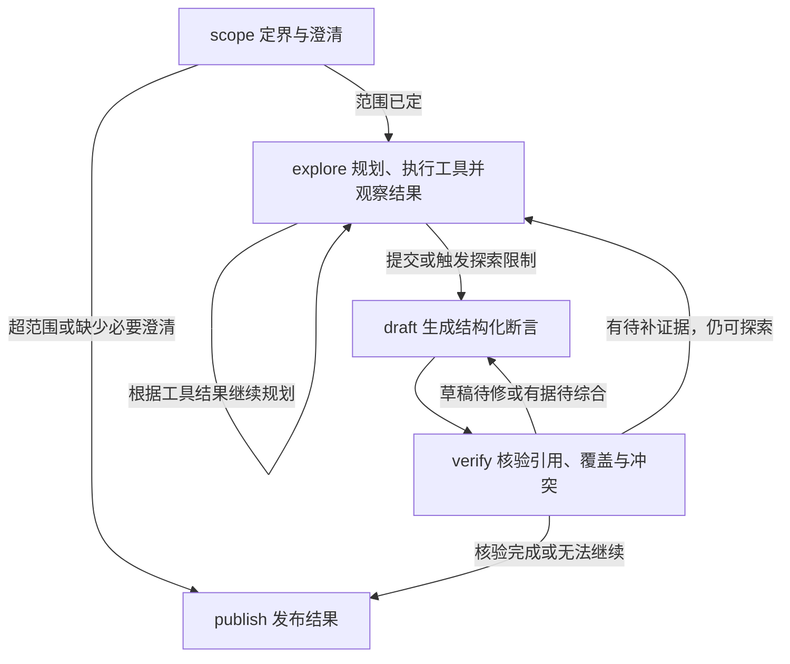
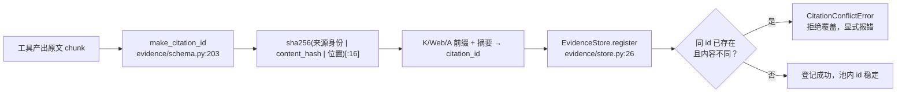
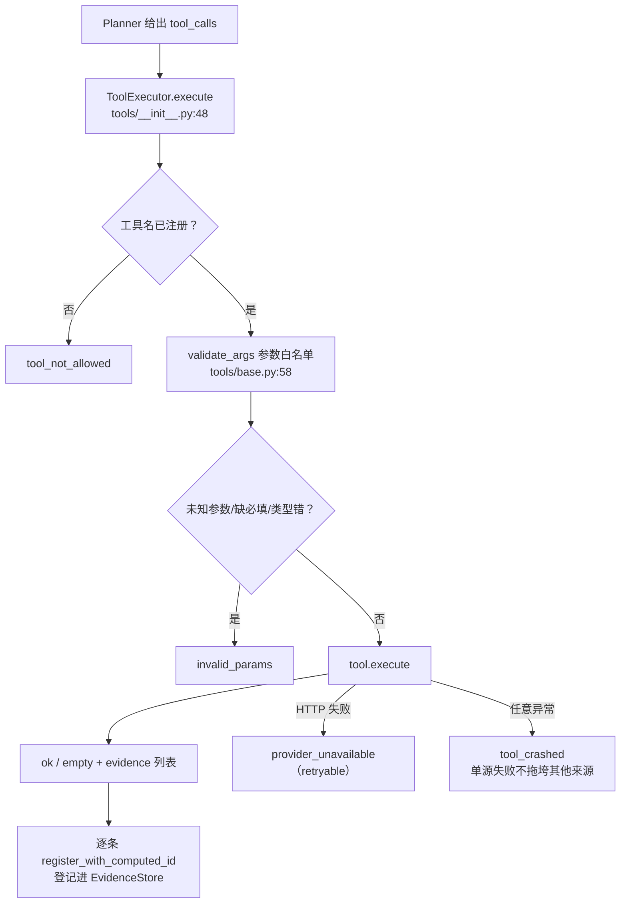
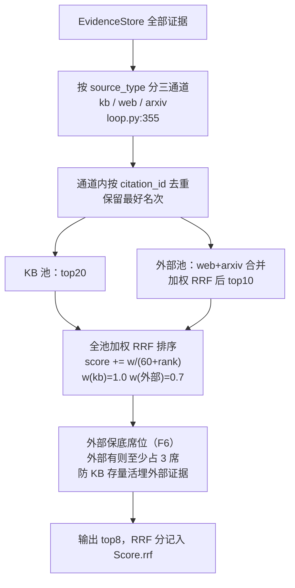
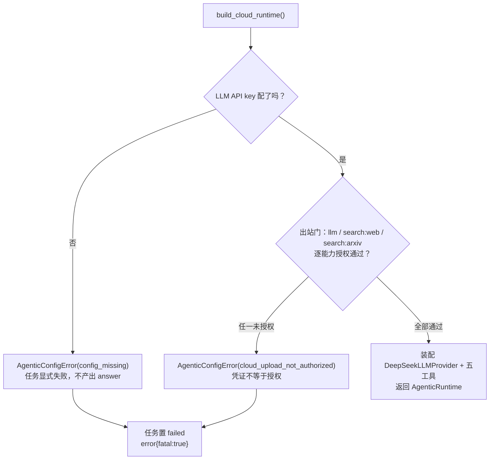
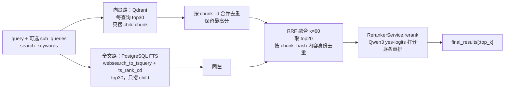
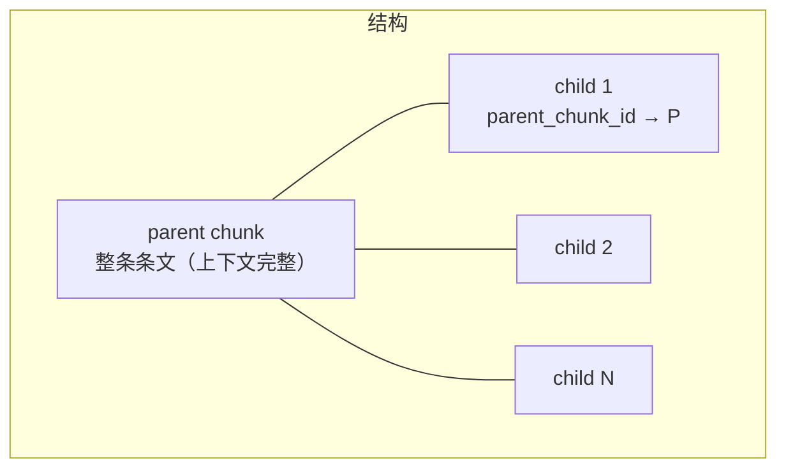
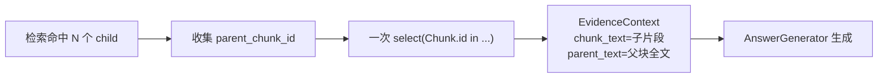
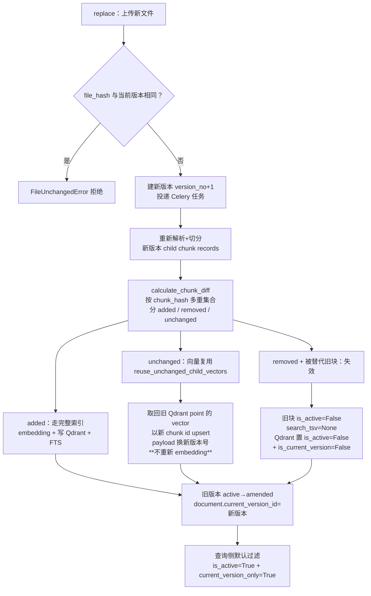
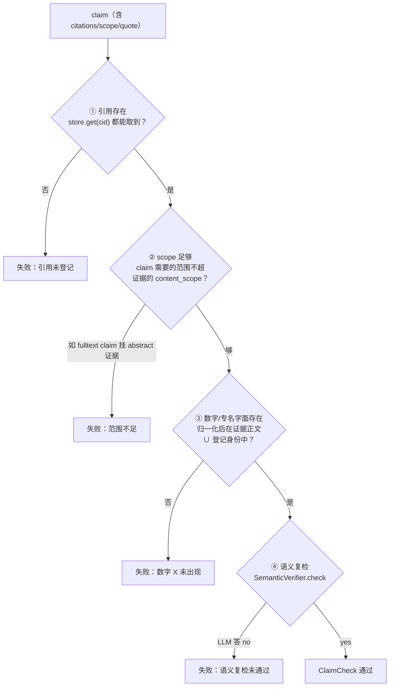

# 实现走读：核心机制快速上手

> 目标读者：第一次接触本仓库、想快速搞懂「系统到底怎么跑起来」的开发者。
> 更新于 2026-11-25。§1 是当前生产 Agent Loop，§11 汇总版本改动与验证状态。

---

## 0. 当前运行入口

| 入口 | 执行路径 | 对外结果 |
|---|---|---|
| `POST /api/v1/tasks` | `AgenticTaskService._run → run_research` | 任务结果、证据、预算和 SSE v1 |
| `POST /api/research`、`POST /api/research/sync` | `ResearchService._execute → run_research` | 兼容旧报告和引用格式。异步入口支持交互澄清 |
| 三段式评测条件 D | `eval/runner.py` 运行同一研究图 | 与固定混合 B、旧 `AgentLoop` C 对照 |

这些路径共用 [research_graph.py](../researcher/deep_research_system/app/graphs/research_graph.py) 的研究图。任务内只有一个持续探索的 Agent，定界、写作和核验各有独立的模型请求。私库仍由 `knowledge_engine` 提供，通过 `kb_search` 接入。版本改动与验收状态见 §11。

## 1. 当前 Agent Loop

三段分别是定界、探索、核验发布。LangGraph 将最后一段拆成 `draft`、`verify` 和 `publish`。每次运行新建一个 `ResearchRun`，在节点间共享计划、探索消息、证据池、预算和核验结果。

1. **定界。** `_scope` 提取至多 4 个子问题、完成标准、假设和所需交付物，并判定是否需要核对现行版本。异步入口最多等待两轮澄清，每轮至多 30 秒且受探索时限约束。同步入口直接按可用的明示假设继续，缺少必要信息且无法假设时结束。定界输出损坏可重试一次，随后采用能恢复的子问题或原问题。
2. **探索。** `_explore` 在同一任务内用已有证据、工具结果、缺口和剩余额度选择下一步。每轮处理最多 6 个调用。模型提交或返回空工具列表时进入写作，预算或无进展限制触发时也尝试用已有证据收尾。非法规划输出留痕并反馈给模型。
3. **草拟与核验。** `_draft` 用多次查询的排序、Reader 融合、主动阅读的摘录和补查材料选出至多 8 条候选证据，Writer 按子问题生成断言。格式损坏或截断时尝试保留可解析的完整断言。`_verify` 逐条检查引用，并检查子问题、指定来源、比较维度和交付物是否覆盖。
4. **回边。** 仍有时间和 token 时，优先修复失败断言或草稿格式，最多两次。若核验认定已有证据足够、报告仍缺步骤或决策条件，则直接回到 `draft` 综合，另有最多两次机会。存在缺证且探索额度允许时，同一任务带着具体缺口回到 `explore`。无进展停机后，已核验的具体缺证可触发一次有界恢复。
5. **发布。** `_publish` 从通过核验且未撤回的断言构造正文。有断言但仍有缺口时返回 `answered` 和 `partial=true`，没有可发布断言时返回 `refused` 并保留可用的检索记录与原因。研究回答状态与 HTTP 任务的 `completed`、`failed`、`cancelled` 分开。

**读代码路线**：[双入口服务](../researcher/deep_research_system/app/services/agentic_service.py) → [图的节点与路由](../researcher/deep_research_system/app/graphs/research_graph.py) 中的 `_compile`、`_explore`、`_after_verify` → [真实图离线回归](../researcher/deep_research_system/tests/test_research_graph.py)。

### 1.1 证据登记：citation_id 为什么稳定

`citation_id` 由**来源身份 + 内容 hash + 位置**共同决定（`evidence/schema.py:203-214`）。
同一 id 指向不同内容必须报错而不是静默覆盖（`evidence/store.py:34-38`）——这是「引用只能来自登记证据」
的存储侧保障，也是 §10 第一步校验的依据。

---

## 2. 共享预算与收尾预留

`/api/v1/tasks` 的默认额度为 3 个探索轮次、12 次工具调用、20,000 个模型 token、180 秒，创建任务时可按 HTTP 契约覆盖。旧报告 API 按 `depth`、`budget_level` 与 `max_sources` 映射额度。

- 定界和探索起初为写作、核验和发布预留一半模型 token、四分之一时限。回流时扣除收尾已用的额度，只保留尚未消耗的部分。
- 所有图节点共用同一个 `Budget`。探索回边、定向补证、草稿修复和语义核验沿用原计数，模型调用计入实际输入与输出用量。
- 探索在轮次、工具调用、token、时限或无进展限制触发时结束。只要还够收尾，已登记证据仍可进入写作与核验。

**读代码路线**：[budget.py](../agent/budget.py) → `ResearchRun.generate`、`exploration_limit` 和 `_tool_batch`。

---

## 3. 工具层契约（tools/）

五个取证工具由 `ToolExecutor` 执行白名单与参数校验，分别为 `kb_search`、`web_search`、`arxiv_search`、`source_fetch` 和 `evidence_read`。探索还可使用 §4 的计划与笔记动作。

契约要点（`tools/base.py:38-51` `ToolResult` 用 `__post_init__` 强制）：
- `status ∈ {ok, empty, error}`；`error` 状态必须带 `ToolError`，非 error 状态禁止带；
- 错误码稳定、信息脱敏、标 `retryable`；
- **provider 异常/模拟数据不得当成功证据**（`tools/base.py:9` 注释即契约）。

`kb_search` 有个值得学的细节（`tools/kb_search.py:61-68`）：KB 地址在**构造时固定**（`KB_INTERNAL_BASE_URL`），
不允许搜索结果指定 URL——防检索内容注入出站目标。

**读代码路线**：`tools/base.py` → `tools/__init__.py` → `tools/kb_search.py`（一个完整工具样例）→
`tools/tests/test_tools.py`（含「失败必须是结构化错误而不是假证据」类用例）。

---

## 4. 探索如何使用工具反馈

- **搜索与阅读。** Agent 按需调用 `kb_search`、`web_search` 或 `arxiv_search`；仅相邻的独立搜索可以并发。网页搜索支持显式 `time_range`。按来源 ID 或已登记证据的 `citation_id` 调用 `source_fetch` 获取正文；用 `evidence_read` 按页或偏移读取并保留同一来源的不同摘录。
- **探索动作。** `record_evidence` 按子问题记录已登记全文的逐字摘录。`revise_plan` 记录子问题增删改及原因。`targeted_research` 用一次模型请求围绕指定缺口选择至多两条搜索，内外调用共用额度和缓存。
- **去重与无进展。** 搜索按工具和去除首尾空白的查询去重，网页的有效时间范围参与去重。失败结果也会缓存。登记新证据、读到新的原文片段或成功记下新摘录会重置无进展计数。连续两次无进展时提醒换源或提交，第三次时停止探索。
- **历史压缩。** 探索历史增长或接近预算时逐步压缩搜索预览，保留可读回的证据 ID。核验回流中新找到或读过的证据优先进入下一次写作。

## 5. Reader 融合：加权 RRF + 外部保底席位（agent/reader.py）

下图是 `agent/reader.py` 的融合规则。生产图在调用 `fuse` 前交错合并各次搜索的排名，并在最终选择中优先保留适用的官方条文、回流补证及主动阅读材料。

三条固定规则（`reader.py:17-23`）：
1. **RRF k=60**，来源权重 kb=1.0、web/arxiv=0.7——加权 RRF 下 KB 第 10 名（1/70≈0.0143）天然压过
   外部第 1 名（0.7/61≈0.0115），所以才有第 3 条；
2. **同一工具的重复调用不计成多张赞成票**（通道内去重）；
3. **外部保底席位**（`reader.py:74-88`）：外部证据有则至少占 `EXTERNAL_RESERVE=3` 席，缺额互补——
   这是修 P4 外部源题全灭的根因（纯 top-N 必然全 KB）。

RRF 与原始分**另存不混比**（`reader.py:92-103`）：`Score.rrf` 记融合分，原始分留在 `raw/raw_channel`，
不跨供应商比较原始分。

**读代码路线**：`agent/reader.py`（全文 104 行）→ `agent/tests/test_loop.py`（融合与保底相关用例）。

---

## 6. 缺云配置显式失败、不 mock（生产契约）

入口：`researcher/deep_research_system/app/services/agentic_service.py:70` `build_cloud_runtime()`。

配套纪律（工具侧同样成立）：`tools/web_search.py` 缺 `TAVILY_API_KEY` 返回结构化 `config_missing`
错误而不是假结果；`providers/llm/deepseek.py:5` 注释明写「缺配置显式失败，不静默降级」。
**生产路径永远不落回本地模型或 mock 证据**；`providers/*/fake.py` 只进测试与 eval 的 fake 模式
（fake 报告带 `mode=fake, not_a_conclusion=true`，且 fake 模式拒绝判门槛）。

**读代码路线**：`agentic_service.py:70-131` → `researcher/deep_research_system/tests/test_agentic_service.py`
（`test_missing_cloud_config_fails_explicitly_without_mock_answer`）→ `tests_bridge/test_p4_eval.py`
（`test_live_mode_requires_cloud_config_and_outbound_approval`）。

---

## 7. KE 混合检索：全文 + 向量 + RRF + 重排

`knowledge_engine/backend/app/services/retriever.py:80` `HybridRetriever.search()`。注意这与 §5 的
Reader 融合是**两层**：KE 内部融合「召回结果」，Reader 融合「跨工具证据」。

分层参数（`retriever.py:98-112`）：两路各召回 30 → RRF 融合截 20 → 重排 → 取 `top_k`。
RRF 的内容身份去重在 `fusion.py:93-100`：优先用 `chunk_hash`，退化到归一化文本 hash——
同一段文本在两路命中只算一条。

重排在 `reranker.py`（本地 Qwen3 权重，见 §13 红线提示）；无 reranker 时直接透传融合序
（`retriever.py:145-147`）。

**读代码路线**：`retriever.py` → `fusion.py`（全文 100 行）→ `keyword_store.py:71-86`（FTS 查询）→
`vector_store.py:209-256`（Qdrant 查询）→ `tests` 里 `test_fusion.py` / `test_retriever.py`。

---

## 8. parent-child 切分与父上下文回取

**切分**（`chunk_service.py:176-212`，法条类；教材类同构在 `:215` 起）：
一个「条文/小节」= 一个 `parent` chunk，长文再切成若干 `child`，child 携带 `parent_local_id`，
落库后回填 `parent_chunk_id` 外键（`models/chunk.py:49` 自引用）。

**检索与回取**：FTS 与向量检索都只搜 child（`keyword_store.py:79`、`vector_store.py:289` 过滤
`chunk_type=child`）——保证命中粒度细；命中后按 `parent_chunk_id` **批量回取父块**，
拼进证据上下文（`query_service.py:195-229` `build_evidence_contexts`）：

好处一句话：**用子片段提高召回精度，用父块保住生成时的上下文完整性**。
父块缺失时 `parent_text` 退化为 child 自身文本（`query_service.py:224`）。

**读代码路线**：`chunk_service.py:176-212` → `models/chunk.py` → `query_service.py:195-229` →
`tests/test_chunk_service.py`。

---

## 9. 版本 + Chunk 哈希：增量更新、向量复用、旧证据失效

入口：`update_service.py:202` `apply_incremental_update()`（replace 类型的异步任务，由
`ingest_worker` 调用）。这是「文档换新版后不全量重建」的完整闭环：

三个机制分工：

| 机制 | 实现 | 行号 |
|---|---|---|
| 版本 | `DocumentVersion.version_no / file_hash / version_status`，旧版 `active→amended` | `models/document_version.py:43-48`、`update_service.py:297-299` |
| Chunk 哈希 | `chunk_hash = hash(normalized_text)`，diff 按**多重集合**比对（重复内容块不误删） | `chunk_service.py:88-91`、`update_service.py:176-199` |
| 向量复用 | unchanged 子块直接搬旧向量到新 point id | `update_service.py:312-341` |
| 旧证据失效 | DB 双标志 + Qdrant payload 可见性 + 查询侧过滤三重 | `update_service.py:286-295`、`metadata_filter.py:27-28` |

**读代码路线**：`update_service.py:176-199`（diff）→ `:202-309`（主流程）→ `:312-341`（向量复用）→
`tests/test_update_service.py`（含 "copies existing vectors without reembedding"）。

---

## 10. 引用闸门（Citation Gate）与部分作答

LLM 不直接写自由文本答案，而是输出**结构化 claims**（`citation_gate.py:37` `Claim`）：
`{claim, citations[], scope, quote}`。闸门逐条四步验证（`citation_gate.py:114-170`）：

四步各防一类幻觉：

1. **存在**——引用必须来自 EvidenceStore 登记（§1.1 的登记语义在这里闭环）；
2. **范围**——`scope` 分级 `snippet < abstract < fulltext`（`citation_gate.py:125-133`），
   摘要证据不能冒充全文做断言。这是「内容覆盖范围」校验，不是字符偏移定位（§13）；
3. **字面**——claim 里的数字、引号内专名必须在证据正文或**登记身份**（arxiv_id/URL/标题/版本号）中出现，
   全角/半角归一化（`citation_gate.py:25, 32-34`）。编号类事实由来源身份承载——正文不含自身 arXiv 号是常态，
   不得因此误拒（`citation_gate.py:135-156`）；
4. **语义**——云模型核对证据是否支撑断言、断言是否实质回答子问题。共享证据或核对法规版本时可批量核验，同批每条断言仍使用各自的引用。适用性核验会查看官方文本的生效、替代、例外和适用条件。

**覆盖与冲突核验。** 逐条通过后，研究图还会检查原始请求与交付物的覆盖情况。只有相反片段能定位到已核验断言或提供给核验器的官方条文时才应用撤回；编号不符时仅在唯一匹配的情况下恢复。无法定位的冲突保留为待核验缺口。

另有 **quote 逐字组装**（`agent/loop.py` 的 `_with_quotes`）：claim 可带 `quote`（证据原文逐字句），
流水线校验它是所引证据 `raw_text` 的归一化子串后**从原文复制**附入答案——逐字命中由构造保证，
不依赖 LLM 转录精度；漂移 quote 直接不采纳。

**读代码路线**：[CitationGate](../agent/citation_gate.py) → [SemanticVerifier 与引文组装](../agent/loop.py) → 研究图的 `_verify_coverage` 和 `_publish`。

---

## 11. 2026-11-25 版本改动与验收状态

| 方面 | 当前行为 |
|---|---|
| 研究入口 | `/api/v1` 与兼容报告 API 共用三段式图。顶层 `AgentLoop` 仍供旧评测条件 C 使用。 |
| 检索与取证 | 同一探索会话持续观察工具结果，支持交互澄清、定向补证和证据 ID 回读。明确区分论文版本、网页时间范围与现行法规条文。抓取受阻时报告原因并提示已启用的替代取证渠道。 |
| 写作与核验 | 优先使用有定位的原文摘录和补查结果，恢复截断草稿中的完整断言。逐条核验后再核对整体覆盖和跨断言冲突，保留具体缺口。 |
| 报告交付 | 对结构化交付物，模型只编排已核验的断言编号，框架可渲染清单、步骤或条件树。重复引用去重，遗漏断言补入「已核验依据」。编排失败时仍交付通过核验的正文。 |
| 研究建议与综合 | 结构化交付且未开启现行版本核验时，草稿可用 `rationale` 标注建议依据。闸门核对依据中的事实，语义复检判断提案是否回应任务并由依据启发。证据足够的综合缺口直接回到 Writer，由 Writer 使用已有证据补齐交付物。 |

最近一次完整的三题 Hy4 样例运行使用 `240c75e`，三题均为部分回答，人工预检 **0/3**。之后 `d39274d` 用已有模型输出离线重放，修复了唯一反证的编号定位。含该修复的版本尚无完整三题云端复跑，正式对照评测尚未启动。评测条件与历史基线见 [three-stage.freeze.json](../eval/baseline/three-stage.freeze.json)，逐题结果见 [testing.md](testing.md#2026-11-25--三题冲突核验实跑及定向重放)。

---

## 12. 测试地图（改完代码跑哪个）

| 机制 | 测试文件 | 代表用例 |
|---|---|---|
| 旧评测循环/停止原因 | `agent/tests/test_loop.py` | `test_repeated_call_without_new_evidence_stops_no_progress` |
| 共享图与双入口 | `researcher/deep_research_system/tests/test_research_graph.py`、`test_api_v1.py`、`test_research_api.py` | 定界与澄清、回流、冲突核验、兼容报告 |
| 预算 | `agent/tests/test_budget_reader.py` | `test_budget_defaults_match_plan` |
| 引用闸门 | `agent/tests/test_citation_gate.py` | scope/数字/专名/语义各一条 |
| quote 组装 | `agent/tests/test_loop.py:537` | 漂移 quote 被剔除 |
| 工具契约 | `tools/tests/test_tools.py` | `test_web_search_missing_key_is_config_error` |
| RRF 融合 | `knowledge_engine/.../tests/test_fusion.py` | — |
| 混合检索 | `.../tests/test_retriever.py` | — |
| 切分/父子 | `.../tests/test_chunk_service.py` | parent_chunk_id 回填 |
| 增量更新/向量复用 | `.../tests/test_update_service.py` | copies existing vectors without reembedding |
| 缺配置显式失败 | `researcher/.../tests/test_agentic_service.py` | `test_missing_cloud_config_fails_explicitly_without_mock_answer` |
| 评测契约 | `tests_bridge/test_p4_eval.py` | 指标纯函数/冻结指纹/fake 端到端 |

命令与基线见 `docs/testing.md`（不要凭记忆跑）。

---

## 13. 已知边界

- 证据的内容范围、登记身份和引文子串由确定性检查约束。语义支持、交付物覆盖和冲突判断仍由云模型给出，最终答复以验收记录中的实测为准。
- 旧对照的 `AgentLoop` 只对同样的工具和参数重复无果时提前停止。生产图使用连续无进展计数，并能依据核验输出的具体缺口回流。
- 私库 embedding 可按已批准的例外使用本地 BAAI/bge-base-en-v1.5，切换模型或维度需匹配或重建索引。仓库还保留本地 reranker 实现，生产路径继续受云端推理约束。研究运行时的云 LLM 缺配置或缺授权时显式失败。
- 私库增量更新目前对旧 child 做软失效。检索限定 child，旧 parent 块仍可能留在存储中。

## 附：建议的阅读顺序

1. 从 §1 和 `research_graph.py` 的 `_compile` 看生产图的节点与两条核验回边。
2. 看 `_explore`、`_after_verify` 和 `test_research_graph.py`，跟踪一次搜索、补证与发布。
3. 从 §10 进入 `citation_gate.py`，核对一条断言如何通过引用和语义检查。
